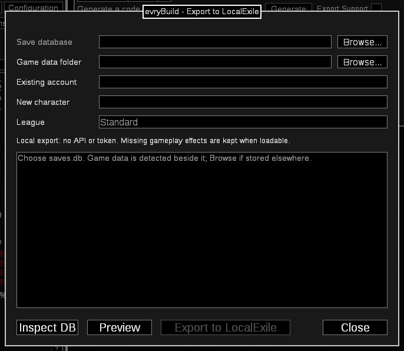

# evryBuild - POB for LocalExile

[Repository](https://github.com/LocalExile/evryBuild) ·
[Portable download and release notes](https://github.com/LocalExile/evryBuild/releases/latest) ·
[Report an issue or suggest a feature](https://github.com/LocalExile/evryBuild/issues)

evryBuild is an offline build planner with **Export to LocalExile** in **Import/Export Build**.
Choose the local server's SQLite save database, preview the current build, and create a new character.
No LocalExile API, token, listening port, plugin, or source changes are required.
The exporter runs once locally, then exits; it is included in the portable package.

Valid equipment, gems and passives are retained even when their gameplay mechanics are not implemented.
Preview distinguishes native encoding omissions from implemented, partial, unimplemented and unknown effects.
Offline compatibility rules belong to this repository; unknown effects are never assumed to work.
See [setup, database safety and compatibility](docs/LocalExile.md).



*Export to LocalExile: select your server's save database, preview the active build, and create a new character.*

[View the full application screenshot](docs/images/localexile-export.png).

All application networking is disabled: official account imports, OAuth, trade, web build sharing,
URL shortening, updates and browser launches are unavailable.
Local XML, pasted build codes, tree-link decoding, clipboard items, comparison builds and planning remain available.

## Portable Windows application

Extract the entire portable ZIP to a writable folder and run **evryBuild.exe** or **evryBuild.cmd**.
The package includes the native runtime and a self-contained Windows x64 exporter.
Running it needs no .NET installation, Python, Git or separate PoB installation.
Builds and preferences remain in the extracted folder. The package contains no personal builds or credentials.
The ZIP includes this README and [the complete setup guide](docs/LocalExile.md).

Use an existing local LocalExile installation with its normal extracted game data and an existing account.
In **Import/Export Build → Export to LocalExile**, select the server's active `saves.db`,
check the detected data folder, enter the account, a new character name and the league, then **Preview** and **Export**.
Return to the game's character screen; log out and back in if the list has not refreshed.
LocalExile can keep running during export. The exporter uses SQLite transactions and creates an online backup first.

For developers packaging this source checkout, install the .NET 10 SDK, PowerShell and Python 3.10+, then run:

```powershell
.\scripts\build-exporter.ps1
python scripts/package-evrybuild.py --destination '..\evryBuild-external-app'
```

Choose a new destination. Packaging checks the exporter executable and source hashes against its build receipt,
so stale helper builds cannot be included accidentally. Compiled output is ignored by Git.
The previously published API-based portable is an older design; it does not contain this external exporter.
Use a package built from this external implementation for an unmodified LocalExile server.
See [local packaging and ZIP instructions](RELEASE.md) in the source repository.

## Development checks

```powershell
.\scripts\build-exporter.ps1
dotnet test tests/LocalExile.Export.Tests
python tests/evrybuild/test_localexile.py -v
python tests/evrybuild/test_exporter.py -v
python -m unittest discover -s scripts -p test_package_evrybuild.py -v
```

[Validation instructions](tests/evrybuild/README.md) include optional real-data testing.
Tests write only temporary databases. Unmodified upstream contract validation is separate from the game-client check.
On 2026-10-29, the owner confirmed that an externally exported level-99 Witch loaded in unmodified LocalExile
`b2737133`, with items and gems present and movement working. This verifies native loading of the tested build;
individual gameplay effects still have the compatibility limits in the setup guide.

## Attribution and license

This fork is based on Path of Building Community Fork master 2.67.2, commit
[b32759ab](https://github.com/PathOfBuildingCommunity/PathOfBuilding/tree/b32759ab0f31a1c8499a0d420cb0f0633d4fe478),
building on Openarl's Path of Building and the work of its community contributors.
These names identify the upstream authors and provenance, not this application's branding.
[LICENSE.md](LICENSE.md) contains the MIT license and third-party notices.
Historical upstream changes remain in [changelog.txt](changelog.txt).
